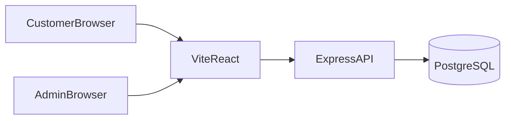
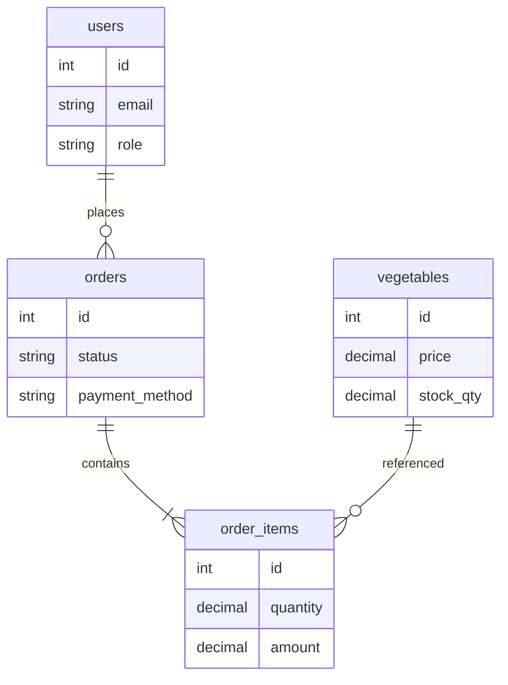

# GreenBasket E-Commerce Learning Roadmap

**Stack locked in:** React (Vite) frontend · Node.js + Express API · PostgreSQL · Customer + Admin roles · COD only (no Razorpay in v1)

**Starting point:** Your current app already has catalogue UI, cart, bill summary, customer fields, print/PDF. You will keep that UI idea and gradually replace hard-coded data (`src/data/vegetables.js`) with a real backend.

---

## Phase 0 — Mindset and vocabulary (1–2 days)

Learn what each piece does before installing anything heavy:

- **Frontend:** what the user sees (your React app)
- **Backend/API:** server that reads/writes data and checks who is logged in
- **Database:** permanent storage (PostgreSQL)
- **Auth:** register/login, sessions or tokens, roles (`customer` vs `admin`)
- **REST:** URLs like `GET /api/vegetables`, `POST /api/orders`

**Checkpoint:** Explain in your own words: browser → API → database.

---

## Phase 1 — Tools you must install and get comfortable with

1. **Node.js + npm** (you already use these)
2. **PostgreSQL** locally (Postgres.app / installer / Docker — pick one and stick to it)
3. **pgAdmin** or **DBeaver** or **psql** — so you can see tables and rows
4. **Postman** or **Thunder Client** — test APIs without the React UI
5. **Git** — commit after each working phase

**Learn:** create a database named `greenbasket`, create one sample table by hand, insert 2 rows, query them.

**Checkpoint:** You can connect to Postgres and run `SELECT 1;`.

---

## Phase 2 — Design the data model (paper first, no code yet)

Draw tables before writing schema. Minimum v1 tables:

| Table | Purpose |
|---|---|
| `users` | id, name, email, phone, password_hash, role (`customer`/`admin`), address, created_at |
| `vegetables` | id, name, description, price, unit, image_url, stock_qty, is_active, updated_at |
| `orders` | id, user_id, status (`pending`/`confirmed`/`delivered`/`cancelled`), payment_method (`cod`), gross_amount, customer snapshot fields, created_at |
| `order_items` | id, order_id, vegetable_id, name_snapshot, price_snapshot, quantity, unit, amount |

**Also decide rules:**

- Prices/names on an order are **snapshots** (don’t change if admin later edits the vegetable)
- Only `admin` can add/edit vegetables and change order status
- Only logged-in `customer` can place an order from their cart
- Guest browsing of catalogue is allowed; checkout requires login

**Checkpoint:** A simple ER sketch (users → orders → order_items → vegetables).

---

## Phase 3 — Learn Express API basics (separate from React at first)

Create a new folder mentally as `backend/` (you will add it later when implementing).

**Learning sequence:**

1. Hello-world Express server on port 5000
2. Connect Express → PostgreSQL (`pg` pool or Prisma/Knex — for learning, start with `pg` so SQL stays visible)
3. CRUD for vegetables only: list, get one, create, update, soft-delete/`is_active`
4. Return JSON; handle errors with clear status codes (400/401/403/404/500)
5. Enable CORS so Vite (`localhost:5173`) can call the API

**Practice with Postman:** add Tomato, list all, update price, deactivate one.

**Checkpoint:** React is still static; API alone can manage vegetables in Postgres.

---

## Phase 4 — Authentication and roles

**Learn concepts in this order:**

1. Never store plain passwords → **bcrypt** hashing
2. Login returns a **JWT** (or session cookie); v1 recommendation: **JWT in Authorization header** (simpler to learn with Vite SPA)
3. Middleware: `requireAuth`, `requireAdmin`
4. Register as customer; seed one admin user manually in DB
5. Protect routes:
   - Public: vegetable list
   - Customer: create order, my orders
   - Admin: vegetable write, all orders, status updates

**Security habits to learn now:** validate input, don’t leak password hashes, expire tokens, don’t trust `role` from the client body (read it from the token/DB).

**Checkpoint:** Postman login as customer vs admin; admin-only route rejects customer token.

---

## Phase 5 — Wire React to the API (make the shop “dynamic”)

Replace hard-coded `src/data/vegetables.js` step by step:

1. Add an `api` helper (base URL, attach JWT)
2. Catalogue loads from `GET /api/vegetables`
3. Keep existing cart UX in React state (cart can stay client-side for v1)
4. Add pages/routes (React Router):
   - Home / catalogue
   - Login / Register
   - Cart + checkout (reuse your customer fields + COD)
   - My Orders
   - Admin: Vegetables, Orders
5. After login, store token + user info; show different nav for admin vs customer
6. Checkout calls `POST /api/orders` with cart lines + address/phone; clear cart on success
7. Keep Print / PDF as post-order invoice features (they already exist)

**Checkpoint:** Adding a vegetable in Admin appears on the customer catalogue after refresh (or refetch).

---

## Phase 6 — Admin panel learning goals

Admin is not a separate app in v1 — same React app, role-gated routes.

Admin must be able to:

- Create / edit / activate-deactivate vegetables (price, unit, stock, image URL)
- See all orders with customer info
- Update status: `pending` → `confirmed` → `delivered` (and `cancelled`)
- See basic counts: today’s orders, pending count (simple dashboard later)

**Checkpoint:** Full loop — customer orders COD → admin confirms → customer sees status on My Orders.

---

## Phase 7 — Orders, stock, and business rules

Before coding these, write the rules down:

- Reject order if any item is inactive or quantity > stock
- Decrease stock when order is placed (or when confirmed — pick one; recommend **on place**)
- Order total computed on **server** (never trust client gross amount)
- Invoice number generated on server
- Customer can only see their own orders

**Checkpoint:** Attempt an oversell in Postman; API returns 400.

---

## Phase 8 — Polish for “real” use (still no online payment)

- Loading and empty states
- Form validation (you already validate phone on the bill)
- Image strategy: start with image URLs; later local upload
- Environment variables: `DATABASE_URL`, `JWT_SECRET`, `CLIENT_URL`
- README: how to run Postgres, backend, frontend
- Seed script: vegetables + one admin account

---

## Phase 9 — What to deliberately postpone (v2+)

Do **not** learn these until v1 works end-to-end:

- Razorpay / UPI online payment
- Real-time Bangalore price sync
- Separate admin mobile app
- Redis, microservices, Kubernetes
- Email/SMS notifications (optional light add-on after v1)

---

## Suggested study order (week-by-week)

| Week | Focus | Outcome |
|---|---|---|
| 1 | Postgres + SQL + data model | Tables exist; you can query them |
| 2 | Express + vegetable CRUD | Postman manages catalogue |
| 3 | Auth + roles | JWT login; admin vs customer |
| 4 | React Router + API wiring | Dynamic catalogue + login UI |
| 5 | Orders + admin order board | Full COD purchase flow |
| 6 | Hardening + seed + README | Demo-ready v1 |

---

## How to learn each phase (method)

1. **Read** one short concept (e.g. “what is a JWT”)
2. **Build** the smallest working slice
3. **Test** with Postman or the UI
4. **Break** it on purpose (wrong password, no token, bad stock)
5. **Write** 3–5 lines in a notes file: what broke and what you fixed

Reuse your existing UI work: cart math, Bangalore prices as seed data, Print/PDF invoice, customer name/phone/address fields — those become checkout + invoice features on top of real orders.

---

## Learning checklist

- [ ] Phase 0 — Concepts vocabulary
- [ ] Phase 1 — PostgreSQL + Postman tools
- [ ] Phase 2 — Data model on paper
- [ ] Phase 3 — Express vegetable CRUD
- [ ] Phase 4 — Auth + roles (JWT)
- [ ] Phase 5 — React wired to API
- [ ] Phase 6 — Admin workflows
- [ ] Phase 7 — Orders + stock rules
- [ ] Phase 8 — Polish + seed + README

---

## Definition of done for v1

- Customer can register, login, browse vegetables from Postgres, cart, place COD order
- Admin can login, manage vegetables, view/update orders
- Prices and stock live in PostgreSQL, not in `vegetables.js`
- No online payment required
- You can demo the full loop on your machine with three terminals: Postgres, Express, Vite
